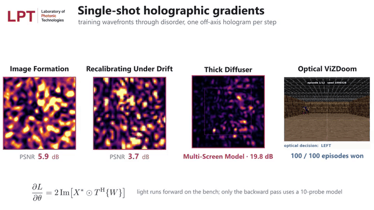

# Single-shot holographic gradients for training wavefronts through disorder 

<p align="center">
  
</p>
<p align="center"><sub>On the bench, one off-axis hologram per training step: an image forming through the diffuser,
recalibration while the diffuser drifts, a thick diffuser modelled with multiple screens, and VizDoom played
all-optically. The notebooks below recreate these experiments in a digital twin.</sub></p>

Digital-twin notebooks for the off-axis holography study: a phase-only SLM, a ground-glass surface diffuser and a camera
with a tilted reference beam. Every camera frame gives the **complex** output field, so the error term of each gradient
is **measured**; only the backward step (the adjoint) needs a model.

The notebooks recreate the study in a NumPy digital twin of the bench. The twin hides the true diffuser and lens
aberrations from the methods and adds the noise sources of the real setup (per-pulse wavefront jitter, laser phase and
energy jitter, shot and read noise, a 12-bit camera, reference-model error, the SLM amplitude response).

## The two arms of the hologram

| Folder | What is trained | How the gradient is obtained | What is modelled |
|---|---|---|---|
| `Object/` | object phase $\theta$ on 32 × 32 SLM cells | in situ: measured field $\hat O$ in the error field, adjoint from a physical model | free space + one thin screen, fitted from 10 probe patterns |
| `Reference/` | reference pattern $E$ on 100 × 100 SLM cells | offline, on object fields measured once with a flat reference | the reference arm only (the diffuser is never modelled) |
| `Joint/` | both, alternating every epoch | $\theta$ in situ, $E$ offline | both arms |

## Notebooks

| Folder | Notebook | Task | Runtime* |
|---|---|---|---|
| `Object/` | `Focusing.ipynb` | hologram → $\hat O$, gradient check, probe sweep (Fig. 2b), focusing (50 iterations) with the 10-probe model vs a 3,072-pattern TM (Fig. 2c,d), single-step focus, a stored TM vs a refitted model after the diffuser moves, focusing while the diffuser drifts slowly (frozen model vs refits, Fig. 4a) | ~2 min |
| `Object/` | `Imaging.ipynb` | yin-yang, clock tower (bench targets) and grating through the diffuser, 300 iterations; model vs TM (Fig. 2e,f); a stored TM vs a refitted model after the diffuser moves; a grating formed while the diffuser drifts slowly (frozen model vs refits, Fig. 4a–d) | ~4 min |
| `Object/` | `Computing.ipynb` | all-optical 10-class classifier (trained phase mask, 10 detector regions), in situ (Fig. 2g–i) | ~2 min |
| `Object/` | `Scaling.ipynb` | 16² to 128² SLM cells: 10-probe model vs TMs from $N$ and $3N$ patterns (Supplementary Note 6, Fig. S9) | ~20 min (fast plan) |
| `Reference/` | `Computing.ipynb` | one frame, two reads (fringe-matched masks of Eq. 7 vs demodulation); reference-arm model; offline-trained reference playing VizDoom *Basic* (demodulated read, the bench's refitted reference model; Fig. 3b,c) and *Defend the Center* (raw-frame read, the bench's detector offsets; Fig. 3d) in closed loop; twin set like the bench build, with a twin-vs-bench table | ~17 min |
| `Reference/` | `Encryption.ipynb` | two-key QR encryption (version-2 codes, the two messages of the SI): key on the reference arm, ciphertext through the 10-probe object model and in situ, one-frame decryption, three attacks (Fig. 3g,h) | ~1 min |
| `Joint/` | `Computing.ipynb` | joint training of both arms on VizDoom *Defend the Center* (Fig. 3d–f; SI Note 4D): θ in situ through the ten-probe object model, E offline on the fields just measured, all-optical raw-frame validation, test and closed loop with the bench's detector offsets; GIFs of the training and of one episode | ~27 min |

\*laptop CPU. The `Object/` notebooks share the optics, the twin bench and the methods in `Object/twin.py` (each function
names its equation in the manuscript); each notebook shows the steps of its experiment, and the focusing, imaging and
scaling runs are saved as GIFs in `Object/gifs/` (measured intensity per iteration next to the metric). The `Reference/`
notebooks use `Object/twin.py` and `Reference/reference.py` (reference arm, two-arm bench with raw camera frames, offline
training); their GIFs (closed-loop game episodes) are in `Reference/gifs/`. The `Joint/` notebook uses
the same two modules; its GIFs are in `Joint/gifs/`.

## Results of the digital twin

| Task | Result |
|---|---|
| Focusing (one speckle grain) | model accuracy 0.86 from 10 probes vs 0.99 from a 3,072-pattern TM; enhancement η ≈ 135 vs 175 after 50 iterations; after a 50 µm move of the diffuser: stored TM accuracy 0.39 and η ≈ 36, model refitted from 10 probes 0.85 and η ≈ 126 |
| Imaging (yin-yang / clock tower / grating, mean of 10 reads, 300 iterations) | 17.8 / 17.7 / 21.2 dB with the 10-probe model vs 18.2 / 18.3 / 21.9 dB with the TM; after a 50 µm move: stored TM 9.0 / 9.9 / 8.9 dB, refitted model 17.2 / 18.1 / 20.6 dB |
| Drift during training (decorrelation 0.3) | focusing: frozen model keeps 34 % of the drift-free η, refits (2 probes + the training frame every 5 iterations) 93 %; grating (mean image, last 10 iterations): no drift 22.3 dB, frozen 7.6 dB, refits 21.4 dB |
| FashionMNIST, all-optical | test accuracy 0.133 (untrained mask) → 0.745 (mask trained in situ); digital logistic regression 0.820 |
| Scaling, 16² → 128² cells | 10-probe model: accuracy 0.85–0.86 at every size, η 90 → 229, grating 9.4 → 18.8 dB per frame; TM from 3N patterns (768–12,288): accuracy 0.99, 1.2–1.4 × the model's η (fast plan, one seed) |
| VizDoom *Basic*, all-optical | demodulated read, the bench's soft detectors, the bench's refitted reference model, no offset correction: test 0.971, recall LEFT / RIGHT / ATTACK 0.98 / 0.97 / 0.90 (bench 0.987); closed loop 100/100 unseen episodes won, 1.2 ± 0.3 steps slower than the oracle (bench 100/100); the raw-frame read takes the same decision on 99.2 % of the frames |
| VizDoom *Defend the Center*, all-optical | plain reference, raw-frame read, hard 24 px detectors, the bench's detector offsets: 6.9 ± 0.9 kills per episode (digital linear, bench recipe, 3.5; random 1.6; oracle 15.4 on VizDoom 1.3.1 here); test balanced accuracy 0.797 raw-frame / 0.803 demodulated (bench, plain: 7.9 and 3.9 kills in two sessions) |
| QR encryption | 2 / 2 messages decrypted from one frame, 10/10 reads each (content BER 0.023 / 0.015, from 0.028 / 0.036 offline); flat reference, wrong key and intensity attacks: BER 0.48–0.52, never decoded |
| Joint training, *Defend the Center* | validation balanced accuracy 0.31 → 0.85; test, raw-frame read, balanced 0.823 (bench 0.763); with the bench's detector offsets 11.2 ± 0.8 kills per episode (linear 3.5, random 1.5; bench 8.8) |

## Running

```bash
pip install -r requirements.txt
jupyter lab
```

* FashionMNIST is downloaded once into `data/` (≈30 MB). `data/imaging_targets.npz` holds the yin-yang and clock-tower
  targets of the bench (128 × 128 camera pixels).
* VizDoom frames are generated with the `vizdoom` package and cached in `data/`. The `Reference/` notebooks run VizDoom
  headless (also on Colab).
* **Colab** (`Reference/` notebooks): upload `Object/twin.py` and `Reference/reference.py` to the Colab working directory,
  and optionally `data/vizdoom_basic.npz` and `data/vizdoom_defend_the_center.npz` to skip generating the game frames;
  the first cell of each notebook installs the missing packages (`vizdoom`, `qrcode`, `opencv-python-headless`).

## Citation
Kerem Ekec, Bahadır Utku Kesgin, and Uğur Teğin "Single-shot holographic gradients for training wavefronts through disorder" arXiv preprint arXiv:2611.27439 (2026).

@misc{ekec2026singleshotholographicgradientstraining,
      title={Single-shot holographic gradients for training wavefronts through disorder}, 
      author={Kerem Ekec and Bahadır Utku Kesgin and Uğur Teğin},
      year={2026},
      eprint={2611.27439},
      archivePrefix={arXiv},
      primaryClass={physics.optics},
      url={https://arxiv.org/abs/2611.27439}, 
}
